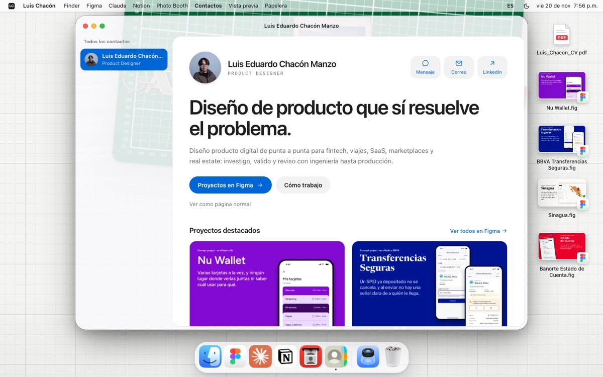
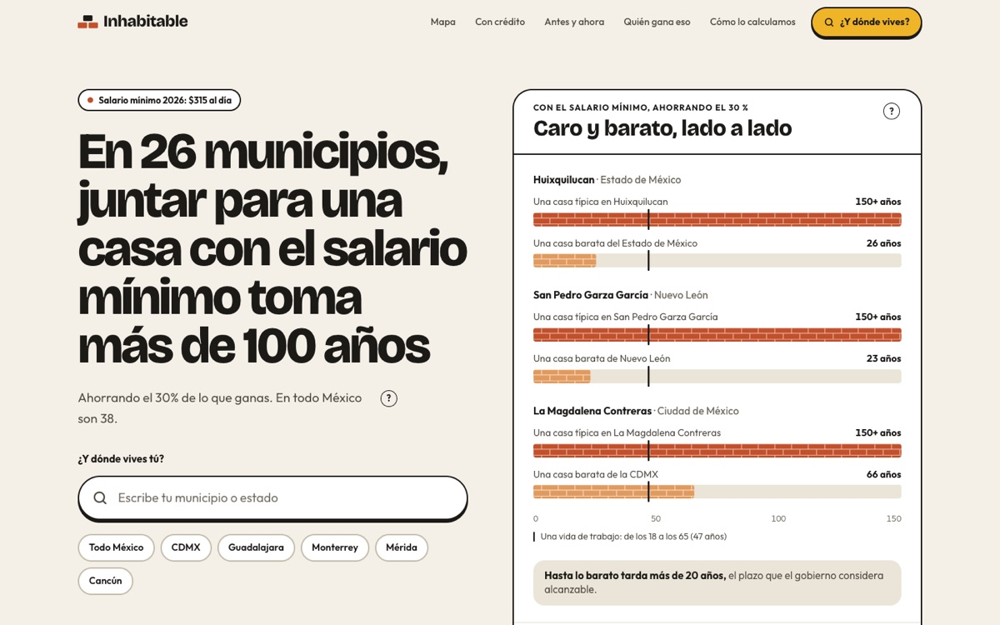
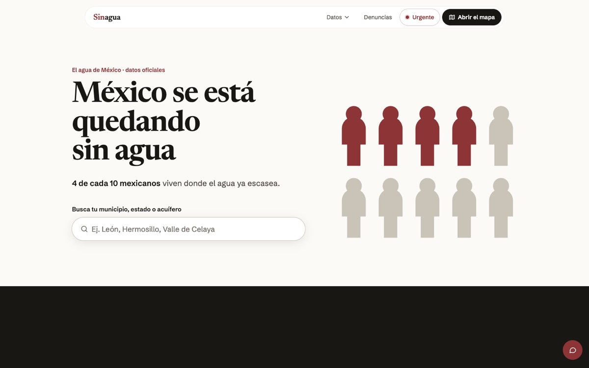
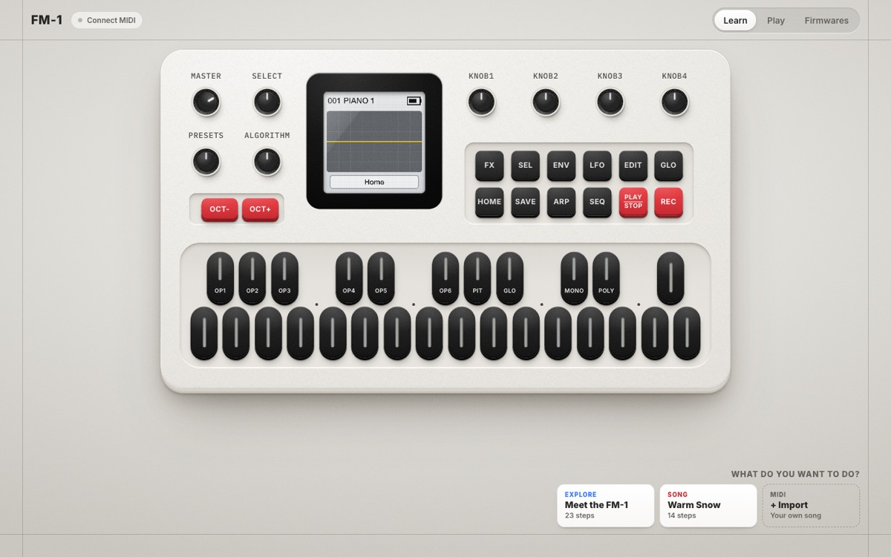

<div align="center">

# Hi, I'm Luis Chacón 👋

### Product Designer who also ships the code

I design digital products end to end (research, validation, high fidelity) and use my software engineering background to take them all the way to production.
Fintech, travel, SaaS, marketplaces and real estate. Based in Colima, México 🇲🇽

[](https://luis-chacon.com)
[](https://www.linkedin.com/in/eduardo-chac%C3%B3n-171367275/)

</div>

---

## ✦ Selected work

<table>
<tr>
<td width="50%" valign="top">
<a href="https://luis-chacon.com"></a>

**[Portfolio](https://luis-chacon.com)** · [code](https://github.com/Exmachia/Portfolio)<br>
My portfolio is a desktop you can explore: open Figma in the dock to see the case studies, or switch to a plain page. English and Spanish.
</td>
<td width="50%" valign="top">
<a href="https://inhabitable.vercel.app"></a>

**[Inhabitable](https://inhabitable.vercel.app)** · [code](https://github.com/Exmachia/inhabitable)<br>
How many years of your life does a house cost on minimum wage in Mexico? 96 in Mexico City. Data journalism with official figures, by state and municipality. *(Spanish)*
</td>
</tr>
<tr>
<td width="50%" valign="top">
<a href="https://www.sinagua.org"></a>

**[Sinagua](https://www.sinagua.org)** · [code](https://github.com/Exmachia/Sinagua)<br>
Mexico is running out of water: drought, dams and aquifers with official CONAGUA data, updated automatically twice a week. *(Spanish)*
</td>
<td width="50%" valign="top">
<a href="https://fm1-sigma.vercel.app"></a>

**[FM-1](https://fm1-sigma.vercel.app)** · [code](https://github.com/Exmachia/fm1)<br>
A playable web replica of the M-VAVE FM-1 synth, built to learn the instrument: 6-operator FM, guided lessons, MIDI import and DX7 export.
</td>
</tr>
</table>

<details>
<summary><b>More projects</b></summary>
<br>

- **[Starvochs Coffee](https://starvochs-coffee-menu.vercel.app)** · [code](https://github.com/Exmachia/Starvochs-coffee-Menu): website for a coffee shop: menu, story and locations.
- **[Bot-Acciones](https://github.com/Exmachia/Bot-Acciones)**: stock alert bot using the post-earnings drift strategy. Simulation only, with a backtest (it doesn't beat the S&P 500).

</details>

## ✦ How I work

```
Research  →  Benchmarking  →  Wireframes  →  High fidelity  →  User testing  →  Handoff  →  Design QA  →  Monitoring
```

I'm comfortable on both sides of the handoff: I prototype in Figma and I can build the real thing: accessible, responsive and measured.

## ✦ Tools

| | |
|---|---|
| **🎨 Design & prototyping** |      |
| **🔍 Research & collaboration** |   |
| **📊 Product analytics** |    |
| **💻 Front-end** |        |
| **🗺️ Data & maps** |   |
| **🤖 AI** |   |
| **🚀 Ship** |   |

---

<div align="center">

**¿Hablas español?** Mis proyectos sociales están en español. Escríbeme por [LinkedIn](https://www.linkedin.com/in/eduardo-chac%C3%B3n-171367275/) 🇲🇽

</div>
